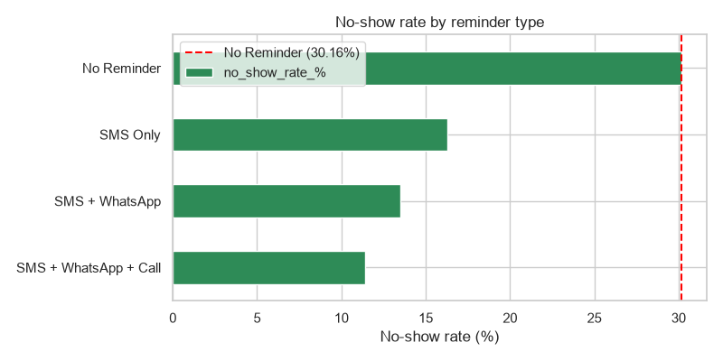
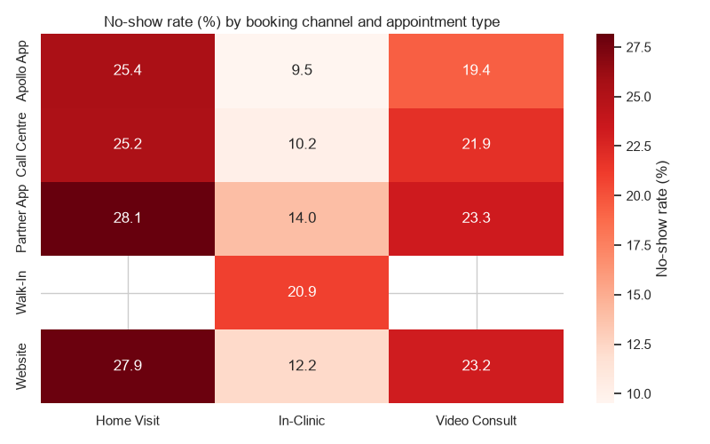
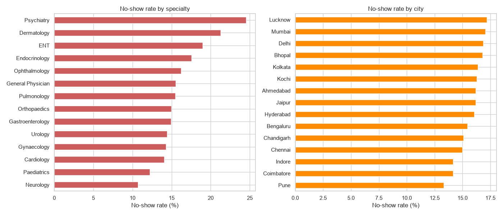
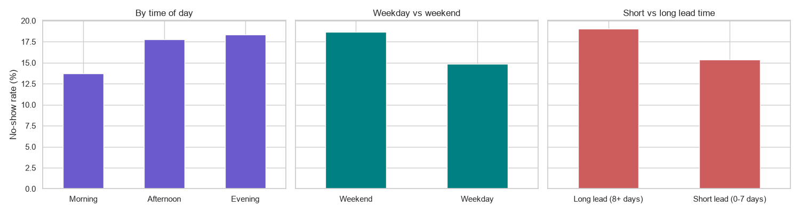
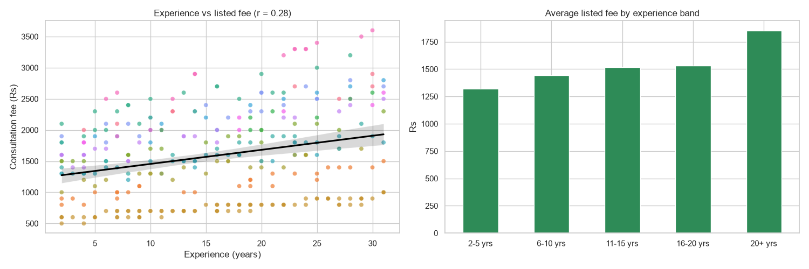

# Apollo Hospitals: Appointment No-Show and Patient Engagement Analysis

Exploratory Data Analysis in Python of **75,000 appointments** across **15 Indian cities** (2022–2024) to find what drives no-shows, how well reminders work, and how much revenue is lost.

**Headline result:** 15.94% of appointments end in a no-show, costing about **₹1.89 crore** in fees. A full reminder bundle (SMS + WhatsApp + Call) cuts the no-show rate from **30.2% to 11.4%**.

---

## Business Problem

Apollo Hospitals offers in-clinic consultations, video consults and home visits. Patients book through the Apollo App, website, call centre, walk-in and partner apps. A large share of booked appointments end in no-shows, which hurts doctor utilisation, revenue and patient health outcomes.

This project answers 21 business questions across six areas:

1. Business overview: volume trends, outcome split, channel mix
2. No-show analysis: by specialty, city, lead time, slot, appointment type and channel
3. Reminder and engagement effectiveness
4. Patient and demographic segmentation
5. Financial performance
6. Doctor utilisation and service quality

## Dataset

| File | Rows | Columns | Grain |
| --- | --- | --- | --- |
| `apollo_appointments_fact.csv` | 75,000 | 52 | One row per appointment |
| `apollo_doctors_dim.csv` | 320 | 15 | One row per doctor |

The two files are joined on `doctor_id` for doctor attributes such as experience and rating.

**Analysis rules followed**
- No-show rate = No-Show ÷ (Completed + No-Show + Cancelled). Scheduled rows are excluded.
- Revenue and quality metrics (wait time, satisfaction, duration, utilisation) use Completed rows only.
- `None` in chronic condition, membership type, insurance provider and cancellation reason means "does not apply", not missing data. The CSV is loaded with `keep_default_na=False` so pandas does not turn these values into NaN.

## Tools

Python 3.13 · pandas · NumPy · Matplotlib · Seaborn · Jupyter Notebook

## Approach

1. **Data checks:** shape, data types, missing values, duplicates, join-key integrity, date range
2. **Preparation:** date parsing, a left join to the doctors table, and helper columns (year-month, weekend flag, lead-time bucket)
3. **Reusable helpers:** a `no_show_rate()` function and separate subsets for outcome rows and completed rows, so every question follows the same rules
4. **Analysis:** one section per business area. Each question has code, a chart and a written insight.
5. **Summary:** key insights, recommendations, and data notes and assumptions

## Key Insights

- **No-shows are costly.** 15.94% of appointments end in a no-show (11,584 of 72,652), about ₹1.89 crore in lost fees, equal to 22% of the ₹8.63 crore billed on completed visits.
- **Reminders are the strongest lever.** The no-show rate falls from 30.2% with no reminder to 16.3% with SMS only and 11.4% with SMS + WhatsApp + Call, a 62% reduction.
- **Appointment type matters most.** Home Visits (26.3%) and Video Consults (21.1%) have about double the no-show rate of In-Clinic visits (12.2%).
- **Specialty matters more than city.** No-show rates range from 10.7% (Neurology) to 24.5% (Psychiatry), but only from 13.3% (Pune) to 17.2% (Lucknow) across cities.
- **Timing increases risk.** Evening slots (18.4% vs 13.7% in the morning), weekends (18.7% vs 14.8%) and bookings made 8+ days ahead (19.1% vs 15.4%) all see higher dropout.
- **Past behaviour predicts future behaviour.** Patients with 2 or more prior no-shows miss 27.5% of appointments, compared with 15.2% for patients with none.
- **Loyalty and channel help.** Apollo members miss 12.7% vs 16.9% for non-members. Apollo App bookings have the lowest channel no-show rate (14.2%); Walk-Ins have the highest (20.9%).
- **Fees rise with experience within each specialty.** Overall, experience is only weakly linked to fee (r = 0.28), but within each specialty the link is very strong (r = 0.86–0.98).

## Recommendations

1. **Make the full reminder bundle the default for every booking.** It cuts no-shows from 30.2% to 11.4%.
2. **Add a confirmation step for high-risk bookings:** Home Visits, Video Consults, Psychiatry, Dermatology, evening and weekend slots, and patients with prior no-shows. Release unconfirmed slots to a waitlist.
3. **Re-confirm bookings made 8+ days ahead** 48 hours before the appointment, and make rescheduling easy.
4. **Grow Apollo App bookings and membership**, since both groups attend more reliably.
5. **Prioritise Psychiatry**, which has both the highest revenue per visit (₹2,640) and the highest no-show rate (24.5%). Halving the overall no-show rate would recover roughly ₹95 lakh.

## Selected Charts

**Reminder effect on no-show rate**



**No-show rate by booking channel and appointment type**



**No-show rate by specialty and city**



**Time of day, weekend and lead time**



**Doctor experience vs consultation fee**



All 21 charts are in the [`images`](images) folder.

## Data Notes and Assumptions

- Lost revenue uses `consultation_fee` on No-Show rows, adjusted by the 96% fee-to-charged ratio seen on completed visits, because `actual_fee_charged` is 0 for no-shows.
- `revenue_realized` equals `patient_out_of_pocket` on every row, so insurer payments are not included in it. `actual_fee_charged` is used where the total amount billed is meant.
- The 66.8% no-show rate for first-time patients is partly due to how the column is defined: a patient who never shows up stays "first-time" on every booking.
- Gynaecology includes 92 male patients and about 12% child patients, which looks like a quirk of the dataset.

## Repository Structure

```
apollo-noshow-analysis/
├── data/
│   ├── apollo_appointments_fact.csv
│   └── apollo_doctors_dim.csv
├── images/              # 21 charts saved from the notebook
├── apollo_eda.ipynb     # full analysis
├── requirements.txt
└── README.md
```

## How to Run

```
pip install -r requirements.txt
jupyter notebook apollo_eda.ipynb
```

Then click **Run → Run All Cells**.
